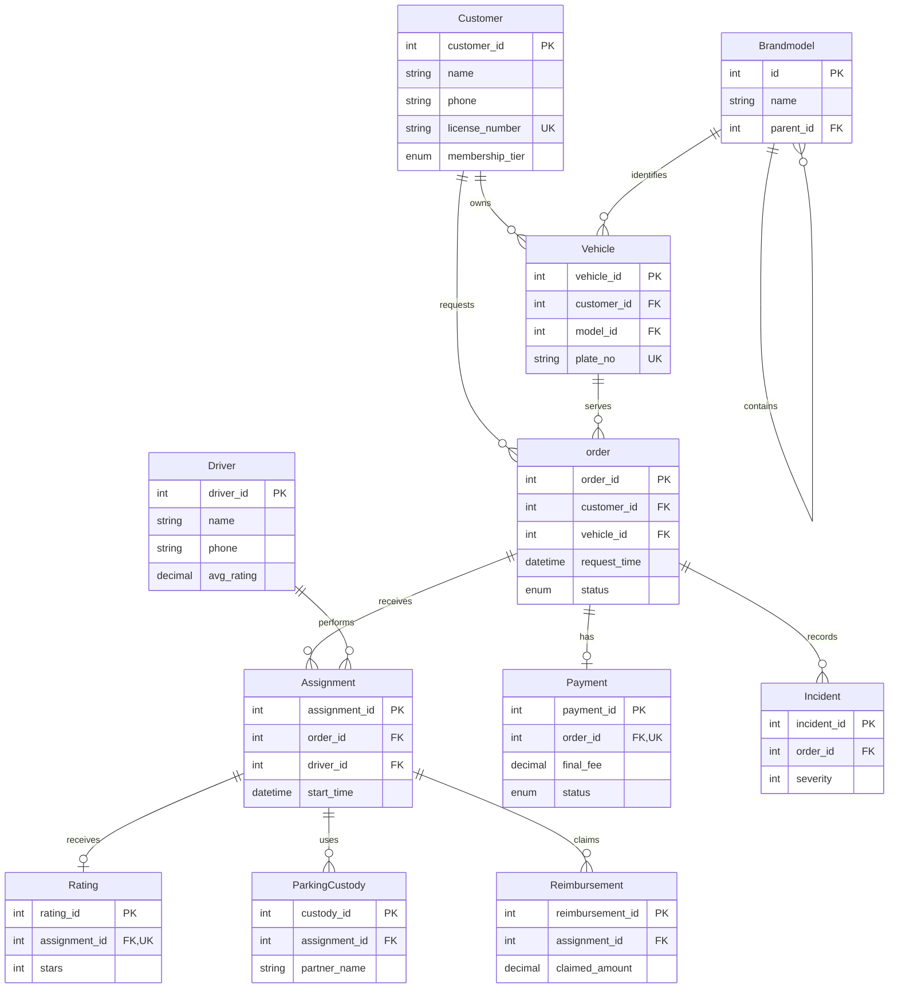

# SafeDrive SQL Analytics

A relational database and analytics project for a fictional designated-driver service, reconstructed from a graduate database coursework project and rerun on MySQL.

All included records are synthetic.

This repository is a pure SQL/relational analytics project. It contains an eleven-table MySQL schema, deterministic fixtures, ten business-question queries, an idempotent rating trigger, assertions, captured TSV outputs, and small verification/audit scripts. It has no machine-learning model, application layer, payment integration, or production data.

## Entity-relationship model



## Query catalogue

Every query file starts with its business question and uses the fixed `as_of` value `2025-11-15 12:00:00`. The result snapshots are deterministic TSVs with headers.

| File | Business question | Main technique | Snapshot rows |
| --- | --- | --- | ---: |
| `q01.sql` | Which customers have a high-severity incident ratio among completed services? | Joins, conditional aggregation | 3 |
| `q02.sql` | Which drivers delivered successful service and paid revenue in the last 30 days? | CTEs, joins, aggregation | 6 |
| `q03.sql` | What are the most common custody routes for each partner in the last 14 days? | CTEs, `ROW_NUMBER() OVER` | 6 |
| `q04.sql` | Which completed services started late, and how many nearby assignments did each driver have? | Correlated subquery | 10 |
| `q05.sql` | What driver rating averages are maintained by the insert trigger? | Trigger summary plus aggregate cross-check | 6 |
| `q06.sql` | Which completed orders belong to VIP customers? | Join and categorical filter | 5 |
| `q07.sql` | How do customer ratings compare across service types? | Grouped aggregates | 3 |
| `q08.sql` | Which customers show repeat purchases in the three months before `as_of`? | CTE, distinct counts, ratios | 6 |
| `q09.sql` | What is the distribution of vehicles across brands and models? | Self-join and grouped count | 5 |
| `q10.sql` | Which completed orders are unpaid, older than 24 hours, and still within seven days of `as_of`? | Fixed rolling-window predicates | 2 |

## Required fixes and design choices

- `00_schema.sql` does not hard-code a database name. The caller selects the database; `scripts/verify.sh` validates the identifier and recreates only that selected database.
- The DDL drops the project trigger and tables in dependency-safe order before recreating them. `20_trigger.sql` drops and recreates its trigger, so it is safe to rerun.
- Fixtures and rolling-window queries use the fixed `as_of` timestamp. There is no `NOW()` or `CURRENT_TIMESTAMP` dependency.
- Scenario 10 requires both conditions: `request_time` is older than 24 hours and is no more than seven days before `as_of`; future rows are excluded too.
- Names, phones, licences, plates, policies, certificates, partner names, and locations are neutral synthetic values. Phones use the `555-01xx` range and identifier-like values use `TEST-*`.
- The ten source business questions and their relational techniques are retained. q02 combines the source's two driver-performance result sets into one stable table, while q05 reads the trigger-maintained summary and `30_assertions.sql` proves an insert update with a rollback.

## How to run

The scripts use the preinstalled MySQL client and do not need network access. The verifier runs the complete load/query/assertion cycle twice and compares all ten outputs byte-for-byte:

```bash
bash scripts/verify.sh --mysql-user root --database safedrive_portfolio_test
python3 scripts/verify_expected_results.py
python3 scripts/audit_public_tree.py
```

`verify.sh` returns status 2 and prints `BLOCKED-DB` if the client cannot connect to MySQL. It returns status 1 for a real SQL, assertion, or idempotency failure. A successful run refreshes `results/q01.tsv` through `results/q10.tsv` from the first deterministic run.

For a manual load, create or select any caller-owned database and use this order:

```bash
mysql -uroot -e "CREATE DATABASE IF NOT EXISTS safedrive_portfolio_test"
mysql -uroot --database=safedrive_portfolio_test < sql/00_schema.sql
mysql -uroot --database=safedrive_portfolio_test < sql/20_trigger.sql
mysql -uroot --database=safedrive_portfolio_test < sql/01_seed.sql
for query in sql/10_queries/q*.sql; do
  mysql -uroot --batch --raw --database=safedrive_portfolio_test < "$query"
done
mysql -uroot --database=safedrive_portfolio_test < sql/30_assertions.sql
```

The SQL files intentionally do not create or select a database, which keeps the database name caller-selected. The verification database is disposable synthetic test data; do not point the verifier at a database that contains data you need to keep.

## Compatibility, assumptions, and limitations

- Target MySQL version: 9.7.1 on macOS. The local client reports 9.7.1; live execution requires an accessible MySQL server. The SQL uses standard MySQL `DELIMITER`, `ENUM`, `CHECK`, CTE, and window-function syntax.
- The fixture clock is a reporting convention, not a live service clock. Dates after `as_of` are intentionally absent.
- The rating trigger is `AFTER INSERT` only. A production system would also define behavior for rating updates/deletes, authorization, concurrency, and audit history.
- The schema models the coursework entities and analytical relationships; it is not a complete dispatch, identity, payment, or custody-control system.
- The committed TSVs are expected snapshots for the included fixture contract. Run the live verifier after changing SQL or fixtures.

## Repository layout

```text
sql/00_schema.sql          caller-selected, rerun-safe DDL
sql/01_seed.sql            synthetic fixtures
sql/10_queries/q01..q10   ten deterministic analytical queries
sql/20_trigger.sql         idempotent rating trigger
sql/30_assertions.sql      fixture, boundary, and trigger assertions
scripts/verify.sh          two-run MySQL verification
scripts/verify_expected_results.py
scripts/audit_public_tree.py
results/q01..q10.tsv       committed result snapshots
```

## License

MIT; see [LICENSE](LICENSE).
