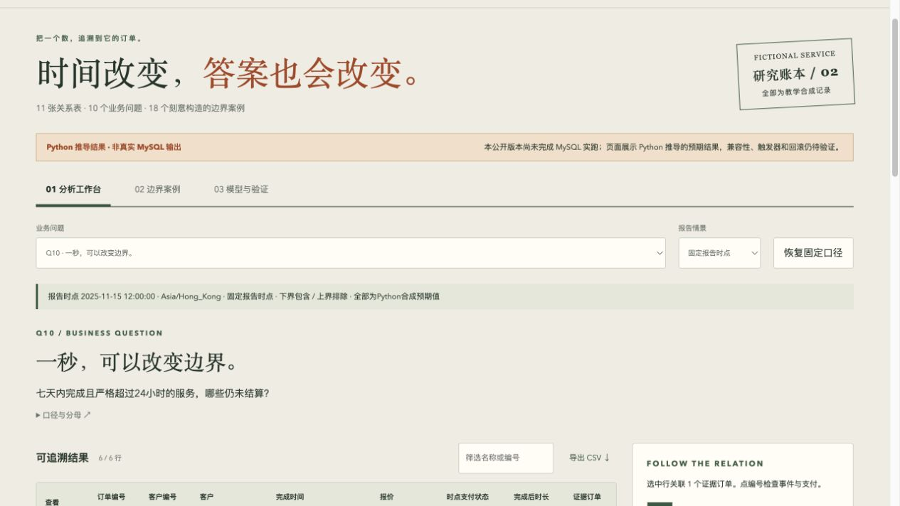
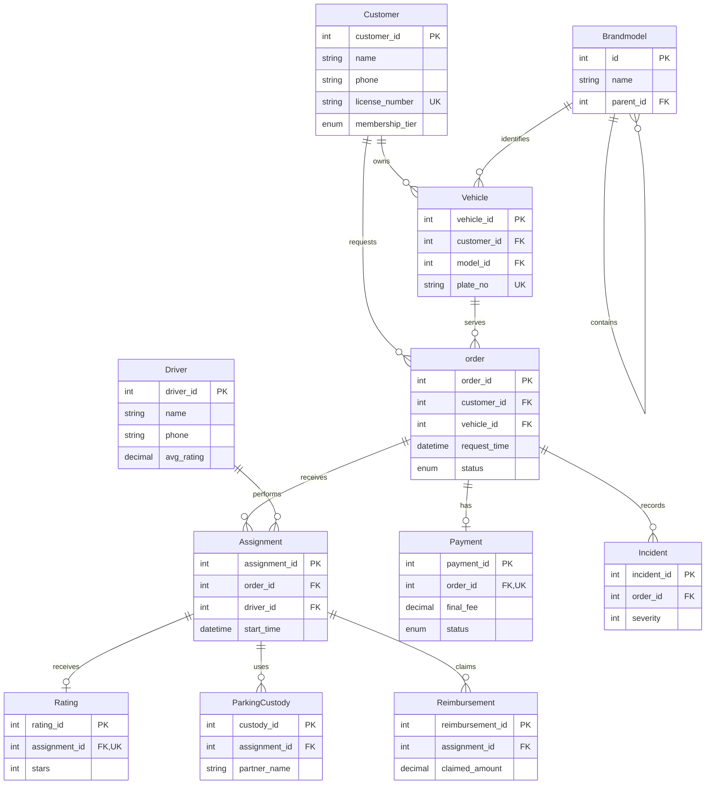

# SafeDrive SQL Analytics · 代驾业务分析与研究账本
Answer business questions on a designated-driver schema — then re-open the research ledger. → [ledger](https://eric-cqc.github.io/safedrive-sql-analytics/research-ledger/web/reader.html)


[](https://github.com/Eric-Cqc/safedrive-sql-analytics/stargazers) · [反馈问题](https://github.com/Eric-Cqc/safedrive-sql-analytics/issues/new/choose) · [查看全部作品](https://github.com/Eric-Cqc)

**从业务问题写出 SQL，再把每个结果追溯到订单、支付和事件。**

以虚构代驾服务为背景的数据库与分析作品：客户、车辆、司机、订单、支付、评价等 11 张关系表，覆盖司机收入、服务质量、复购和逾期未结算等 10 个问题。所有演示记录均为合成数据。

## 先看交互版

**[打开 SQL 研究账本](https://eric-cqc.github.io/safedrive-sql-analytics/research-ledger/web/reader.html)** · [新版使用说明](research-ledger/USER_GUIDE.md) · [直接查看 SQL](research-ledger/sql/10_queries/)



例如：“哪些已完成的订单超过 24 小时仍未结算？”先选择 Q10，查看结果，再把时点后移一小时；页面会显示新增和移出的订单。点击一行可以追到原始事件、支付状态和时间边界，而不只得到一个总数。

另一个问题是：“司机收入应该按服务完成时间，还是收款发生时间计算？”Q02 将这两种口径分开，让结果的含义可检查。

## 这份作品展示什么

| 能力 | 具体实现 |
| --- | --- |
| 关系建模 | 11 张表的主外键关系、订单与履约/支付/评价的连接 |
| SQL 分析 | 多表关联、CTE、窗口函数、条件汇总及时间窗口 |
| 业务口径 | 区分订单与事件、服务与现金、缺失与零值、退款与复购 |
| 可核验输出 | 33 笔合成订单、18 个边界案例、7 种情景和逐行证据 |

交互版还可查看情景 SQL、导出预期结果 CSV，并保存带引用的分析笔记。它是分析阅读器，浏览器不运行 MySQL。

## 两个版本，分别阅读

| 位置 | 内容 | 验证边界 |
| --- | --- | --- |
| 根目录 `sql/`、`results/`、`scripts/` | 保留的基础课程重构版及原有 TSV 结果 | 保留既有实现与历史快照；本次未重跑其数据库 |
| [`research-ledger/`](research-ledger/) | 新增交互账本、扩展口径和独立 Python 校验 | 页面与 CSV 展示 Python 推导的预期值；MySQL 9.7.1 两库实跑、六组参数探针、触发器、约束和回滚已通过 |

2026-10-18 对新增公开副本核验：18 项 Python 单测、10 份预期 TSV 对照、JavaScript 语法和公开文件审查通过；浏览器实际验证了情景切换、订单证据、笔记保存/刷新恢复、CSV 下载及业务问题切换。随后补完 MySQL 9.7.1 两个独立合成库实跑，十查询及六组参数探针均与 oracle 对照通过，触发器、约束拒绝和回滚通过。查看 [实跑记录](research-ledger/evidence/mysql-verification.json) 与 [结果文件](research-ledger/results/)。这不是生产负载验证。

## 下载后使用新版

下载仓库，打开 `research-ledger/web/reader.html`。保留完整目录，保证原始夹具与证据链接可访问。也可以在仓库根目录用现有 Python 启动本地静态服务：

```sh
python3 -m http.server 8000 --bind 127.0.0.1
```

然后访问 `http://127.0.0.1:8000/research-ledger/web/reader.html`。只想阅读无需安装数据库。新版的计算复核与受保护的 MySQL 验证步骤见其 [README](research-ledger/README.md)。

---

## 基础 SQL 版本：结构与复现

以下是保留的基础版文档；其中的纯 SQL 范围与历史结果只指根目录基础版，不指上面的交互账本。

A relational database and analytics project for a fictional designated-driver service, reconstructed from a graduate database coursework project and rerun on MySQL.

All included records are synthetic.

This repository is a pure SQL/relational analytics project. It contains an eleven-table MySQL schema, deterministic fixtures, ten business-question queries, an idempotent rating trigger, assertions, captured TSV outputs, and small verification/audit scripts. It has no machine-learning model, application layer, payment integration, or production data.

## Entity-relationship model



## Query catalogue

Every query file starts with its business question and uses the fixed `as_of` value `2025-11-15 12:00:00`. The result snapshots are deterministic TSVs with headers.

| File | Business question | Main technique | Snapshot rows |
| --- | --- | --- | ---: |
| `q01.sql` | Which customers have a high-severity incident ratio among completed services? | Joins, conditional aggregation | 3 |
| `q02.sql` | Which drivers delivered successful service and paid revenue in the last 30 days? | CTEs, joins, aggregation | 6 |
| `q03.sql` | What are the most common custody routes for each partner in the last 14 days? | CTEs, `ROW_NUMBER() OVER` | 6 |
| `q04.sql` | Which completed services started late, and how many nearby assignments did each driver have? | Correlated subquery | 10 |
| `q05.sql` | What driver rating averages are maintained by the insert trigger? | Trigger summary plus aggregate cross-check | 6 |
| `q06.sql` | Which completed orders belong to VIP customers? | Join and categorical filter | 5 |
| `q07.sql` | How do customer ratings compare across service types? | Grouped aggregates | 3 |
| `q08.sql` | Which customers show repeat purchases among completed orders with a payment record before `as_of`? | CTE, payment join, distinct counts, ratios | 4 |
| `q09.sql` | What is the distribution of vehicles across brands and models? | Self-join and grouped count | 5 |
| `q10.sql` | Which completed orders are unpaid, older than 24 hours, and still within seven days of `as_of`? | Fixed rolling-window predicates | 2 |

## Required fixes and design choices

- `00_schema.sql` does not hard-code a database name. The caller selects the database; `scripts/verify.sh` validates the identifier and recreates only that selected database.
- The DDL drops the project trigger and tables in dependency-safe order before recreating them. `20_trigger.sql` drops and recreates its trigger, so it is safe to rerun.
- Fixtures and rolling-window queries use the fixed `as_of` timestamp. There is no `NOW()` or `CURRENT_TIMESTAMP` dependency.
- Scenario 10 requires both conditions: `request_time` is older than 24 hours and is no more than seven days before `as_of`; future rows are excluded too.
- Names, phones, licences, plates, policies, certificates, partner names, and locations are neutral synthetic values. Phones use the `555-01xx` range and identifier-like values use `TEST-*`.
- The ten source business questions and their relational techniques are retained. q02 combines the source's two driver-performance result sets into one stable table, while q05 reads the trigger-maintained summary and `30_assertions.sql` proves an insert update with a rollback.

## How to run

The scripts use the preinstalled MySQL client and do not need network access. The verifier runs the complete load/query/assertion cycle twice and compares all ten outputs byte-for-byte:

```bash
bash scripts/verify.sh --mysql-user root --database safedrive_portfolio_test
python3 scripts/verify_expected_results.py
python3 scripts/audit_public_tree.py
```

For password-protected MySQL, append `-p` to the `mysql` commands or use a client option file such as `~/.my.cnf`; keep passwords out of this repository.

`verify.sh` returns status 2 and prints `BLOCKED-DB` if the client cannot connect to MySQL. It returns status 1 for a real SQL, assertion, or idempotency failure. A successful run refreshes `results/q01.tsv` through `results/q10.tsv` from the first deterministic run.

For a manual load, create or select any caller-owned database and use this order:

```bash
mysql -uroot -e "CREATE DATABASE IF NOT EXISTS safedrive_portfolio_test"
mysql -uroot --database=safedrive_portfolio_test < sql/00_schema.sql
mysql -uroot --database=safedrive_portfolio_test < sql/20_trigger.sql
mysql -uroot --database=safedrive_portfolio_test < sql/01_seed.sql
for query in sql/10_queries/q*.sql; do
  mysql -uroot --batch --raw --database=safedrive_portfolio_test < "$query"
done
mysql -uroot --database=safedrive_portfolio_test < sql/30_assertions.sql
```

The SQL files intentionally do not create or select a database, which keeps the database name caller-selected. The verification database is disposable synthetic test data; do not point the verifier at a database that contains data you need to keep.

## Compatibility, assumptions, and limitations

- Target MySQL version: 9.7.1 on macOS. The local client reports 9.7.1; live execution requires an accessible MySQL server. The SQL uses standard MySQL `DELIMITER`, `ENUM`, `CHECK`, CTE, and window-function syntax.
- The fixture clock is a reporting convention, not a live service clock. Dates after `as_of` are intentionally absent.
- The rating trigger is `AFTER INSERT` only. A production system would also define behavior for rating updates/deletes, authorization, concurrency, and audit history.
- The schema models the coursework entities and analytical relationships; it is not a complete dispatch, identity, payment, or custody-control system.
- The committed TSVs are expected snapshots for the included fixture contract. Run the live verifier after changing SQL or fixtures.

## Repository layout

```text
sql/00_schema.sql          caller-selected, rerun-safe DDL
sql/01_seed.sql            synthetic fixtures
sql/10_queries/q01..q10   ten deterministic analytical queries
sql/20_trigger.sql         idempotent rating trigger
sql/30_assertions.sql      fixture, boundary, and trigger assertions
scripts/verify.sh          two-run MySQL verification
scripts/verify_expected_results.py
scripts/audit_public_tree.py
results/q01..q10.tsv       committed result snapshots
```

## License

MIT; see [LICENSE](LICENSE).

## 使用、反馈与关注

如果这个项目对你有帮助，欢迎点击仓库右上角 **Star**；想跟进版本更新，可用 **Watch → Custom → Releases**。遇到问题请提交复现步骤、预期与实际结果；也欢迎分享希望解决的业务问题。请只使用合成或已脱敏示例，不提交密钥、个人信息或真实客户资料。

查看 [参与说明](CONTRIBUTING.md)。
